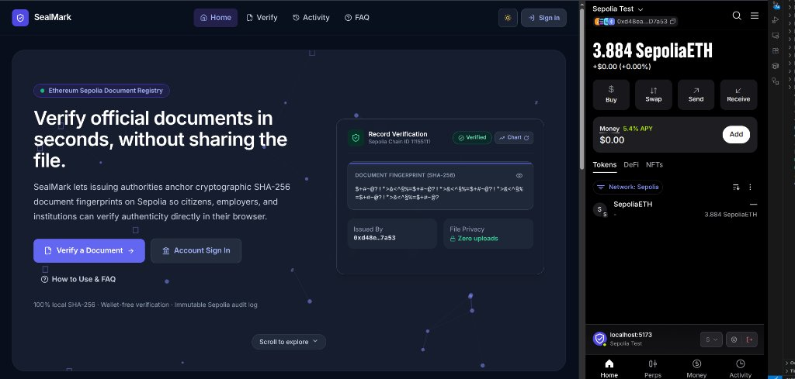
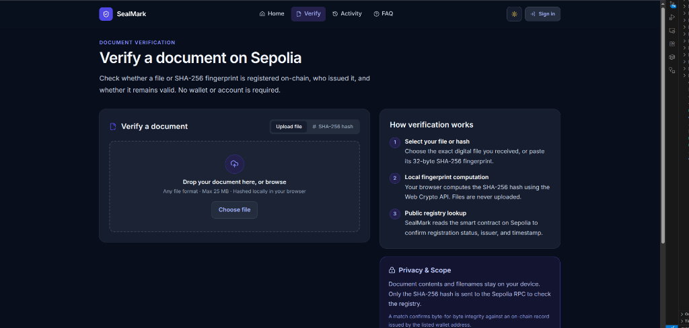
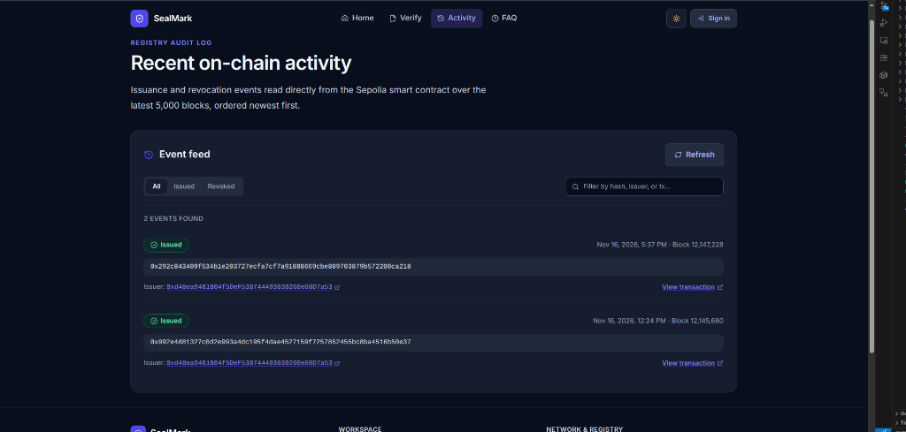
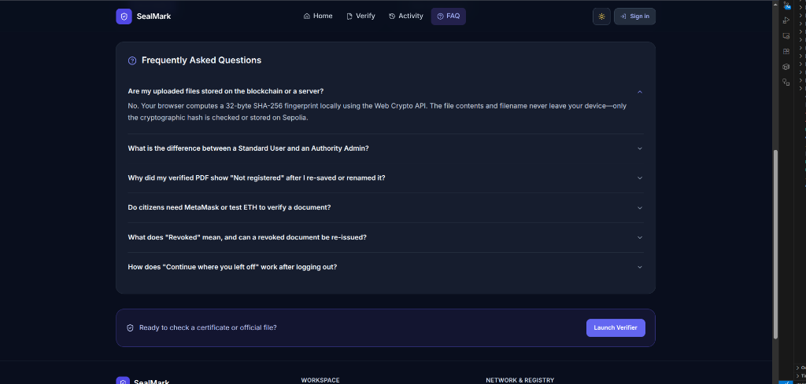

# SealMark

**Decentralized document verification and authority registry on the Ethereum Sepolia test network.**

**Live Deployment:** <https://sealmark-dapp.vercel.app> · **Smart Contract (Sepolia):** [`0x1f188319a11993F6436EB8cBE1Ca5FC4C12C816E`](https://sepolia.etherscan.io/address/0x1f188319a11993F6436EB8cBE1Ca5FC4C12C816E)

SealMark allows authorized issuing institutions to anchor cryptographic SHA-256 document fingerprints (`bytes32`) on-chain using the `DocChainRegistry` smart contract. Citizens, employers, and third parties can verify any file or SHA-256 hash directly in the browser without MetaMask or file uploads—document bytes and filenames never leave the user's device.

## Features

- **Smart Contract Registry (`DocChainRegistry.sol`):** Owner-managed issuer whitelist (`addIssuer`, `removeIssuer`), tamper-evident document registration (`issue`), permanent revocation by the original issuer (`revoke`), and zero-gas public lookup (`verify`, `isIssuer`).
- **Wallet-Free Public Verification:** Verify documents by file drop (local Web Crypto SHA-256 hashing up to 25 MB) or by pasting a `0x`-prefixed SHA-256 hash.
- **Role-Based Access Control:** Separate workflows for **Standard Users** (verify documents, view audit logs, customize profile) and **Authority Admins** (connect MetaMask on Sepolia to issue, revoke, and administer issuers).
- **Live On-Chain Activity Feed:** Queries `DocumentIssued` and `DocumentRevoked` events across the latest 5,000 Sepolia blocks with type filters (`All`, `Issued`, `Revoked`), search, pagination, and Sepolia Etherscan links.
- **Interactive UI & Account Profiles:** Progress-gated splash loader, particle-animated landing page with a flippable live usage line chart, radial light/dark theme transition, Guide & FAQ page, profile/avatar customization, PBKDF2-secured local accounts, and session resume after logout.

## Tech Stack

- **Smart Contract:** Solidity `0.8.20`, Hardhat `2.29.1`, Chai
- **Frontend:** React `19`, Vite `8`, Tailwind CSS `3`, React Router `7`, `lucide-react`, `ethers.js` `6`
- **Testing:** Hardhat unit tests, Node `--test` helper tests, Playwright browser E2E tests

## Contract Address & Test Network

| Field | Value |
| --- | --- |
| **Test Network** | Ethereum Sepolia (`Chain ID: 11155111`) |
| **Contract Address** | [`0x1f188319a11993F6436EB8cBE1Ca5FC4C12C816E`](https://sepolia.etherscan.io/address/0x1f188319a11993F6436EB8cBE1Ca5FC4C12C816E) |
| **Deployment Transaction** | [`0xae984d7a14e39004fc9ef356447f31cbbdee400e2a8b6d8795f15aed4c5747e6`](https://sepolia.etherscan.io/tx/0xae984d7a14e39004fc9ef356447f31cbbdee400e2a8b6d8795f15aed4c5747e6) |
| **Deployment Block** | `12145646` |
| **Contract Owner & Authorized Issuer** | `0xd48ea9481804f5DeF538744493830260e60D7a53` |
| **Issuer Authorization Transaction** | [`0xdd75f1aa99937828620683e5d807e5c1cb9bed79d8d1268c8506abbae3ffded1`](https://sepolia.etherscan.io/tx/0xdd75f1aa99937828620683e5d807e5c1cb9bed79d8d1268c8506abbae3ffded1) |
| **Live Hosted Frontend (Vercel)** | <https://sealmark-dapp.vercel.app> |

## Project Structure

```text
contracts/          Solidity smart contract (DocChainRegistry.sol)
test/               Hardhat smart contract & ABI tests
scripts/            Preflight, Sepolia deployment, issuer authorization, ABI sync
deployments/        Recorded public deployment manifest
frontend/src/       React UI (Landing, Verify, Admin/Issue, Activity, FAQ, Profile, Login)
frontend/test/      Frontend unit tests (hashing, auth, errors, config, activity)
e2e/                Playwright end-to-end tests against an isolated local EVM
docs/               Setup runbook, technical viva report, and demo files
```

## Steps to Deploy the Smart Contract

> Use a dedicated **test-only** wallet funded with Sepolia test ETH. Never commit `.env` files or private keys.

1. **Install dependencies:**
   ```bash
   npm ci
   npm --prefix frontend ci
   ```

2. **Configure root `.env` from `.env.example`:**
   ```env
   SEPOLIA_RPC_URL=https://eth-sepolia.g.alchemy.com/v2/YOUR_API_KEY
   DEPLOYER_PRIVATE_KEY=0xYOUR_TEST_WALLET_PRIVATE_KEY
   ISSUER_ADDRESS=0xYOUR_METAMASK_PUBLIC_ADDRESS
   CONTRACT_ADDRESS=
   ```

3. **Run preflight and deploy to Sepolia:**
   ```bash
   npm run preflight
   npm run deploy
   ```
   The deploy script writes the deployment manifest to `deployments/sepolia-<address>.json`.

4. **Authorize the issuing wallet:**
   Copy the deployed address into `CONTRACT_ADDRESS` in root `.env`, then run:
   ```bash
   npm run add-issuer
   ```

## Steps to Run the Frontend

1. **Create `frontend/.env` from `frontend/.env.example`:**
   ```env
   VITE_CONTRACT_ADDRESS=0x1f188319a11993F6436EB8cBE1Ca5FC4C12C816E
   VITE_RPC_URL=https://eth-sepolia.g.alchemy.com/v2/YOUR_API_KEY
   VITE_CHAIN_ID=11155111
   VITE_EXPLORER_URL=https://sepolia.etherscan.io
   ```

2. **Verify deployment alignment and start the development server:**
   ```bash
   npm run check-deployment
   npm --prefix frontend run dev
   ```
   Open the local URL printed by Vite (e.g., `http://localhost:5173`).

3. **Build for production or run all automated tests:**
   ```bash
   npm run check
   npm run test:e2e
   ```

## Screenshots

### Landing Page & MetaMask Sepolia Wallet


### Document Verification (Wallet-Free SHA-256 Check)


### Live On-Chain Activity Audit Log


### Guide & Frequently Asked Questions


## Documentation

- [Technical & Viva Report](docs/REPORT.md) — Architecture, smart contract mechanics, `ethers.js` interaction flow, and viva Q&A notes.
- [Setup Runbook](docs/SETUP.md) — Detailed wallet, faucet, RPC, and hosting instructions.
